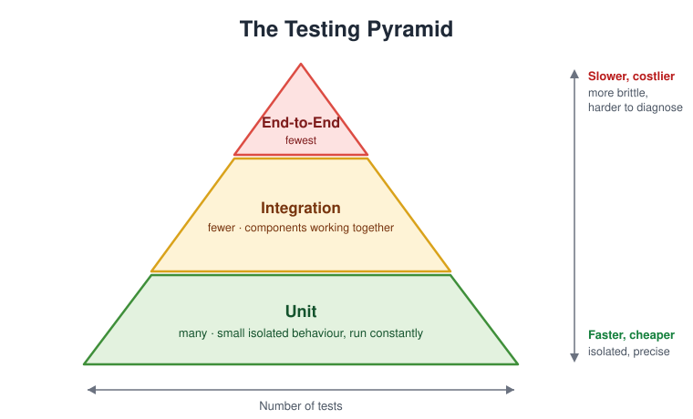
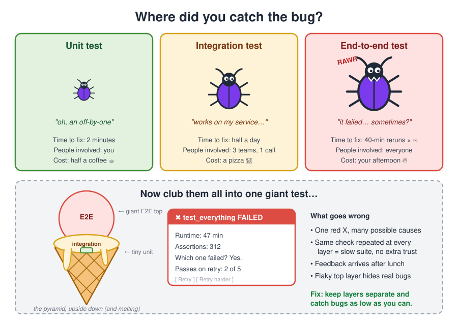

# Testing Pyramid

The testing pyramid is a rule of thumb for balancing automated tests by cost and feedback speed.

The base should contain many fast unit tests because they isolate small behavior and can run constantly. The middle contains fewer integration tests because they check collaboration between components but cost more to set up and debug. The top contains the smallest number of end-to-end tests because they exercise real workflows but are slower, more brittle, and harder to diagnose.

The pyramid is not saying that higher-level tests are unimportant. It is saying that expensive tests should prove only what cheaper tests cannot. Repeating the same assertion at every layer creates a slow test suite without adding much confidence.

## Related

- [[Testing Principles]]
- [[Test Driven Dev]]
- [[Maintaining code base]]
