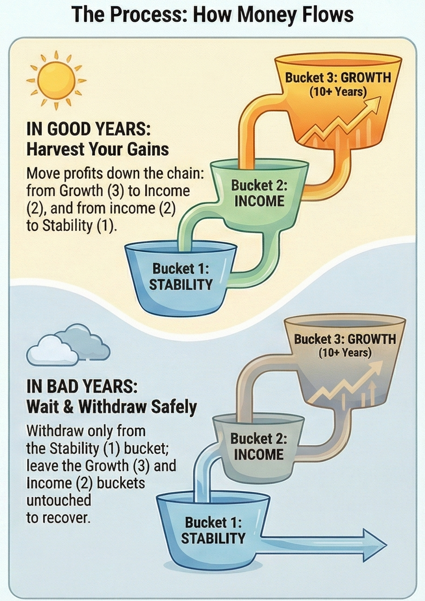

# three bucket investment strategy

Need steady cash flow (EMI, expenses). Market doesn't give steady returns. +20% one year, -30% the next.
Withdraw in a bad year → sell at a loss → corpus dies early.
That is **sequence-of-returns risk**. Order of gains and losses matters when you are withdrawing.

Fix: split money by *when* you need it.

## The buckets

| Bucket | Time horizon | Purpose |
| --- | --- | --- |
| 1. Stability | 0–3 years | fund cash flow with low-volatility assets |
| 2. Income | 3–7 years | refill Bucket 1, moderate risk |
| 3. Growth | 10+ years | beat inflation, refill Bucket 2 |

**Bucket 1: Stability (33%)**
- Liquid, money market, ultra-short / short-term debt (corporate bond, credit risk), FDs.
- Holds 3 years of withdrawals. No panic. Protects the SWP in a crash.
- Expected 6-7%. Never runs dry; refilled from Bucket 2.

**Bucket 2: Income (33%)**
- Conservative hybrid, equity savings, low-volatility Balanced Advantage, short duration, multi-asset.
- The core "ISR bucket". Stable, low-volatility returns. Refills Bucket 1 every year.
- Expected 8-10%. Buffer zone.

**Bucket 3: Growth (33%)**
- Flexicap, large & midcap, multicap, index, international equity.
- Inflation fighter. Refills Bucket 2 in good years.
- Expected 12-15%. NEVER touch during a crash. Let it recover.



- Good years: harvest gains, move money down (3 → 2 → 1).
- Bad years: don't sell. Bucket 1 has 3 years of buffer. Wait.

Think wine: grapes go to the cellar (B3, 10+ years), young wine to the cabinet (B2, 3-5 years), ready-to-drink to the table (B1, 1-3 years).

## How much corpus

```text
Corpus = Monthly Cash Flow × 12 × ISR
```

[[Income Stability Ration(ISR)]] = multiplier by goal duration.

| Goal Type | Duration | ISR | Example |
| --- | --- | --- | --- |
| Indefinite (wealth preservation) | Forever | 17.5 | Passive income |
| Long-term (loan payoff) | 15-20 years | 10-12 | Home loan EMI |
| Medium-term | 10-15 years | 8-10 | Education fund |
| Short-term | 5-10 years | 5-7 | Car loan, renovation |

| Monthly Need | Goal | ISR | Corpus Required |
| --- | --- | --- | --- |
| ₹50,000 | Passive income | 17.5 | ₹1.05 Crore |
| ₹50,000 | 15-year loan EMI | 12 | ₹72 Lakhs |
| ₹1,00,000 | Passive income | 17.5 | ₹2.10 Crore |
| ₹1,00,000 | 15-year loan EMI | 12 | ₹1.44 Crore |

Lower ISR = smaller corpus, but it depletes to zero.
Higher ISR (17.5) = bigger corpus, never depletes.
Payoff goals: 20-year → 10-12, 15-year → 8-10, 10-year → 6-8.

## When to move money

| Trigger | Action |
| --- | --- |
| Bucket 1 < 1 year of cash flow | Refill from Bucket 2 |
| Bucket 2 < 3 years runway | Refill from Bucket 3 |
| Bucket 3 up >15% in a year | Harvest gains to Bucket 2 |
| Market crash | Do nothing. Wait. |

- B2 → B1: every 1-2 years.
- B3 → B2: every 3-5 years.
- Start of year: B1 < 1 year? → B2 has gains? move B2 → B1. Else B3 has gains? move B3 → B2 → B1. Else wait.

## 15-year loan simulation

₹3.5 Cr corpus, ₹50L annual EMI.

| Year | Bucket 1 | Bucket 2 | Bucket 3 | Total | EMI paid | Note |
| --- | --- | --- | --- | --- | --- | --- |
| 0 | ₹1.20 Cr | ₹1.20 Cr | ₹1.10 Cr | ₹3.50 Cr | ₹0 | |
| 1 | ₹0.75 Cr | ₹1.30 Cr | ₹1.25 Cr | ₹3.30 Cr | ₹50L | B2 +8%, B3 +14% |
| 2 | ₹0.30 Cr | ₹1.40 Cr | ₹1.43 Cr | ₹3.13 Cr | ₹1.0 Cr | B1 running low |
| 3 | ₹0.90 Cr | ₹1.00 Cr | ₹1.63 Cr | ₹3.53 Cr | ₹1.5 Cr | refill B2 → B1 |
| 5 | ₹0.40 Cr | ₹1.20 Cr | ₹1.50 Cr | ₹3.10 Cr | ₹2.5 Cr | refill B3 → B2 |
| 7 | ₹0.85 Cr | ₹0.95 Cr | ₹1.80 Cr | ₹3.60 Cr | ₹3.5 Cr | refill B2 → B1 |

Result: ₹7.5 Cr paid over 15 years. ₹90L left.

## Stress test: March 2020 crash (-35%)

| Date | Bucket 1 | Bucket 2 | Bucket 3 | Action |
| --- | --- | --- | --- | --- |
| Jan 2020 | ₹1.20 Cr | ₹1.20 Cr | ₹1.10 Cr | Normal |
| Mar 2020 | ₹1.15 Cr | ₹1.00 Cr | ₹0.72 Cr | Crash. Don't sell. |
| Dec 2020 | ₹0.70 Cr | ₹1.20 Cr | ₹1.10 Cr | Recovered. |
| Mar 2021 | ₹0.65 Cr | ₹1.30 Cr | ₹1.30 Cr | Harvest B3 gains. |

Never sold at the bottom. Bucket 1 bought the time.

## Rising costs

Need grows 6% a year: ₹1,00,000 (yr 1) → ₹1,26,248 (yr 5) → ₹1,68,948 (yr 10) → ₹3,02,560 (yr 20).
Equity in Bucket 3 grows faster than 6%, so it funds the increase.
Fixed EMI? Not needed. EMI stays constant.

## Options

| Bucket | India | US |
| --- | --- | --- |
| 1 Stability | HDFC Liquid, ICICI Money Market, Axis Short Term, Bank FD | SGOV, VGSH, Money Market (SPAXX), T-Bills |
| 2 Income | ICICI Equity Savings, HDFC Balanced Advantage, ICICI Multi-Asset | SCHD, VBIAX, JEPI, AOK |
| 3 Growth | Parag Parikh Flexi Cap, Mirae Large & Midcap, UTI Nifty 50 Index | VTI, VOO, QQQ, VGT |

Returns and ISR are planning assumptions, not guarantees. Not advice. Check taxes, inflation and withdrawal rate with an adviser before acting.
